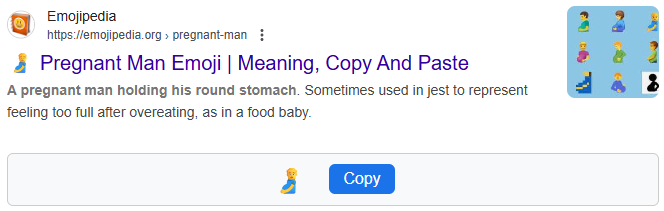
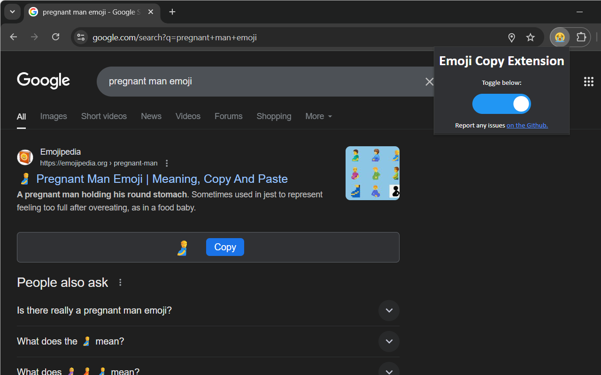
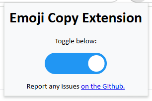
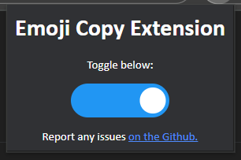

my idea was clearly sooo good, that google decided to implement their own native emoji copying function. so, this extension has become much less useful, and will become useless once google covers ALL the emoji search queries. however, it is still alive for now

# Emoji Copy Extension
Have you ever [Google](https://www.google.com/)d the name of an emoji in hopes of copying it but were met with the formatting of the search results which didn't let you select and copy the emoji in plain text easily? Or the emoji wasn't in the search results, forcing you to go on a website like [Emojipedia.org](https://emojipedia.org/) to copy it?   
This Chrome Extension injects a box under the Emojipedia.org search result on any Google search which allows the user to copy the respective emoji, as seen in the example below.

<table>
  <tr>
    <th width=1000px>
      
    </th>
    <th width=1000px>
      
    </th>
  </tr>
</table>

## Usage

1. [Install from the Chrome Web Store.](https://chromewebstore.google.com/detail/emoji-copy-extension/nhkpcjdklcgchjejlnfdpgpcgmailpik?utm_source=github&utm_medium=readme_md)
2. A copy button will now be available under any Emojipedia.org search results in Google.
* You may toggle the extension by clicking on it in the extensions toolbox and sliding the switch:
<table>
  <tr>
    <th width=1000px>
      
    </th>
    <th width=1000px>
      
    </th>
  </tr>
</table>
